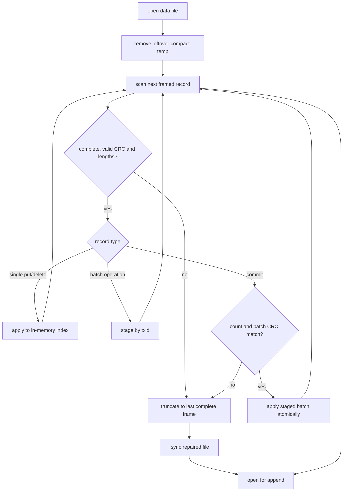

# Architecture and Evidence

## Scope

This document describes the implementation in `kvdb.py`, the CLI in `cli.py`, and the independent tester in `torture.py`. Evidence is intentionally conservative: a design argument is not marked as a passing test unless the corresponding test was actually run.

## Design summary

The database is a single-process, embedded, append-only log with an in-memory dictionary index. The authoritative state is one file, for example `data.kdb`. A temporary file named `data.kdb.compact.tmp` is used only during compaction and is never authoritative.

A single `threading.RLock` protects the file and index. This gives concurrent callers a simple serialization point. `get()` takes the same lock, so it cannot observe an index while a batch is being applied.

## Record format

Every record is encoded in big-endian binary form:

```text
header = magic[4] | version[1] | record_type[1] | txid[8]
       | key_length[4] | value_length[4] | op_index[4] | op_count[4]
payload = key bytes followed by value bytes
trailer = CRC32(header + payload)[4]
```

The implementation constants are `MAGIC=b"KDB1"`, `VERSION=1`, `PUT=1`, `DELETE=2`, and `COMMIT=3`. A normal put or delete has `txid=0`, `op_count=1`, and `op_index=0`. A batch operation has a nonzero transaction id and a sequential operation index. Its commit record contains a CRC32 of all operation frames in its payload and is valid only when the expected number of operation frames is present.

The decoder validates magic, version, record type, lengths, frame completeness, and CRC. A value may be empty and may be at most 1 MiB; a key is 1 to 1,024 bytes.

## Write ordering

For a single put or delete:

1. Acquire the global lock.
2. Encode one complete record.
3. Preflight the configured logical size limit.
4. Append the frame.
5. Flush Python's file object.
6. Call `os.fsync()`.
7. Update the in-memory index.
8. Return to the caller.

For a batch, all operation records and then one commit frame are appended before one flush and `fsync()`. Only after that succeeds are all operations applied to the index. Therefore an acknowledged write has passed the durability point before success is returned.

If a process dies before the acknowledgment, the operation may be absent or present. If it dies after `fsync()` but before the response reaches the caller, recovery may find the complete record or committed batch and apply it; this is allowed by the challenge invariant.

## Recovery flow



An incomplete tail, invalid frame, incomplete batch, or invalid commit is not applied. The file is truncated to the last known-good boundary. Recovery is deterministic and idempotent for the valid prefix. The current implementation does not attempt to recover a valid frame after an invalid middle record; that is acceptable for the crash/torn-tail model but is a documented limitation.

## Compaction flow

`compact()` holds the global lock, snapshots live index entries, writes only complete `PUT` frames to `data.kdb.compact.tmp`, flushes and `fsync()`s that file, closes the old file, and calls `os.replace(temp, data.kdb)`. It then attempts to `fsync()` the containing directory and reopens the replacement. If killed before replacement, the old file remains at the authoritative path. If killed after replacement, the replacement was already synced. On the next open, a leftover temporary file is removed and ignored.

The implementation checks `max_bytes` while building the compacted file. If the compacted representation cannot fit, it raises `DiskFullError` before replacement, leaving the old file authoritative.

## Size-limit behavior

Before any normal append, `_durable_append()` calculates the current file size plus all complete encoded frames. If this exceeds `max_bytes`, it raises `DiskFullError` before writing any bytes. This makes the tested logical-cap failure clean and preserves the previous index. A physical operating-system `ENOSPC` fault is not simulated by the current tests.

## Independent test evidence

The parent of `torture.py` owns an independent dictionary oracle. It does not use `dump` or the database's own index as expected truth. Each child operation is considered acknowledged only after a response is received. After a random `SIGKILL`, the child is restarted and the observed state must equal the state before or after the unacknowledged operation. For a batch, the full state must equal one complete before/after state, not a mixture.

Observed run:

```text
python3 torture.py run --iterations 100 --seed 424242
crash_test: 100 iterations, 68 acknowledged, 32 killed, 12 keys checked
thread_test: 4 threads, 160 writes, 160 present
```

The engine unit suite also passed six tests, including persistence, incomplete tail, incomplete batch, compaction shrink/reopen, and logical size-limit rejection.

## Required scenario evidence

Status meanings:

- **Verified:** a test directly exercised the scenario or a sufficiently close implementation-level case.
- **Partial:** related behavior was tested, but not the exact kill point or scale stated by the challenge.
- **Not verified:** no direct evidence was collected; the design/code location is listed for review.

| ID | Required scenario | Actual code | Evidence/status |
|---|---|---|---|
| A1 | Kill before any put bytes reach the file | `KVDatabase.put`, `_durable_append` | Not verified: no pre-write kill injection. |
| A2 | Kill during a torn put record | `_recover` frame/CRC validation | Partial: `test_incomplete_tail_is_ignored_and_truncated` appends an incomplete tail, but does not kill during a live put. |
| A3 | Kill after record write before fsync | `_durable_append` | Not verified: no fsync failpoint. |
| A4 | Kill after fsync before put response | `put`, `_durable_append` | Not verified at the exact boundary; durability ordering is visible in code. |
| A5 | Kill immediately after put response | `put`, `torture.py` | Partial: random torture acknowledged 68 puts/operations and restarted, but did not target the exact post-response instant. |
| A6 | Kill during delete | `delete`, `_recover` | Partial: delete persistence and random single-operation kills were tested, not an exact delete failpoint. |
| A7 | Kill during a 1 MiB put | `_check_value`, `put` | Not verified at 1 MiB under kill; size validation allows it. |
| B1 | Kill after 3 of 10 batch operations | `batch`, `_recover` pending batches | Not verified at the exact third-record point. |
| B2 | Kill after batch records but before commit | `batch`, commit staging | Partial: `test_batch_without_commit_is_not_visible_after_reopen` proves an uncommitted valid batch record is ignored, but not a live kill after ten records. |
| B3 | Kill after commit write before fsync | `batch`, `_recover` | Not verified at the exact commit/fsync boundary. |
| B4 | Kill after batch success | `batch`, `torture.py` | Partial: successful batches survive unit reopen and random torture; exact post-response timing is not targeted. |
| B5 | Put X then delete X in one batch | `batch`, `test_batch_is_applied_in_order_and_survives_reopen` | Verified: sequential order is documented and final X is absent after reopen. |
| B6 | Kill halfway through a 10,000-operation batch and recover under 2 seconds | `batch`, `_recover` | Not verified: no 10,000-operation kill or timing measurement. |
| C1 | Kill while replaying during open | `_recover` | Not verified: no recovery failpoint. |
| C2 | Kill while truncating/repairing a torn tail | `_recover` | Partial: torn-tail repair and reopen pass; no kill during the truncate call. |
| C3 | Kill during compaction before replacement | `compact` | Not verified with a compaction failpoint; replacement ordering preserves the old path until swap. |
| C4 | Kill during rename/swap | `compact`, `os.replace` | Not verified at the rename instruction. |
| C5 | Kill after swap before temp cleanup | `open`, `compact` | Partial: a leftover incomplete `.compact.tmp` was manually created; open ignored/removed it and preserved live data. |
| C6 | Kill during close | `close` | Partial: close/reopen and random process kills pass; no close-specific kill injection. |
| D1 | Two writers, different keys, killed randomly | global `RLock`, `torture.py` | Partial: four concurrent threads wrote 160 distinct keys; no two-writer kill run. |
| D2 | Two writers, same key, killed randomly | global `RLock`, `put` | Not verified with same-key kill workload. |
| D3 | Long batch plus single puts, killed randomly | global `RLock`, `batch` | Not verified with this exact mixed workload. |
| D4 | Reader during a batch | global `RLock`, `get`, `batch` | Not verified with a targeted reader observer; lock ordering supports before/after visibility. |
| E1 | Cap reached during single put | `_durable_append`, `DiskFullError` | Verified for the logical cap: put rejected and prior value remained readable after reopen. |
| E2 | Cap reached during batch | `batch`, `_durable_append` | Partial: preflight rejects the whole batch before appending; halfway physical `ENOSPC` was not simulated. |
| E3 | Cap reached then process killed | `DiskFullError`, `_recover` | Not verified with a kill after a capped failure. |
| E4 | Cap reached during compaction | `compact` | Partial: compacted output checks `max_bytes` before replacement; a direct cap-during-compaction test was not run. |
| E5 | Deletes free space and later writes work | `delete`, `compact` | Partial: deletes plus compaction shrink was tested; a separate post-compaction write-after-space test is not recorded. |
| F1 | 500 consecutive random kills/restarts | `torture.py` | Partial: 100 iterations with 32 kills passed; 500 was not run. |
| F2 | Repeated kills during recovery | `_recover` | Not verified: no recovery-stage kill failpoint. |
| F3 | 1,000,000 keys and under-2-second recovery | `_recover` | Not verified: no million-key benchmark was run. |
| F4 | Hand-truncate final byte | `_recover` | Partial: an incomplete appended tail was repaired; exact one-byte truncation of a valid final record was not run. |

The table is deliberately not a claim that every challenge row passes. It is the current evidence boundary.

## Final bounded optimization result

The recovery scanner now uses a read-only memory map for sequential frame parsing, while retaining the same magic, length, CRC, batch, and truncation checks. On the same one-million-key workload, recovery improved from 4.574 seconds to 3.027 seconds and all 1,000,000 keys were recovered. This remains above the required two seconds and is documented as an unmet performance target, not a pass.
