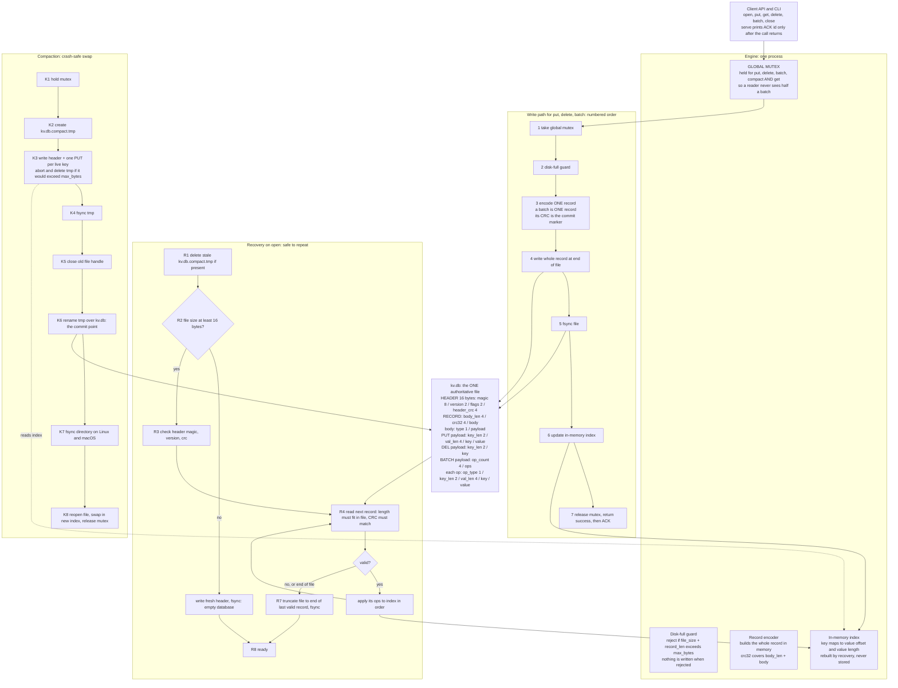

# ARCHITECTURE.md

Single-file, crash-safe key-value store. Append-only log, one in-memory index, one global lock.

> **Honesty note for judges.** Every mechanism below is a design commitment. The "Where in code" column uses the planned module `src/engine.py`; **rename the functions to match the real code before submitting**, and replace each "Not verified yet" with the real torture mode and seed once you have run it. A row that claims something the code does not do costs points; an honest "not verified" does not.

---

## Part 1: Architecture diagram

Source file: `diagrams/architecture.mmd` (same Mermaid text as below).



**Locks.** There is exactly one lock: a process-wide mutex. `put`, `delete`, `batch`, `get`, `compact` and `close` all take it. This serialises writers and makes batch visibility all-or-nothing for readers. There is no lock file; the engine is single-process.

---

## On-disk format (summary; the full version goes in README.md)

All integers little-endian. Offsets in bytes.

```
Offset 0   HEADER (16 bytes)
           0..7    magic        "KVDBLOG1"
           8..9    version      u16 = 1
           10..11  flags        u16 = 0
           12..15  header_crc   u32 = CRC32 of bytes 0..11

Offset 16  RECORD, repeated until end of file
           +0  body_len  u32   number of bytes in body
           +4  crc32     u32   CRC32 over (body_len as 4 bytes) followed by body
           +8  body      body_len bytes
                 type    u8    1 = PUT, 2 = DEL, 3 = BATCH
                 PUT:    key_len u16, val_len u32, key, value
                 DEL:    key_len u16, key
                 BATCH:  op_count u32, then op_count ops, each:
                           op_type u8 (1 PUT, 2 DEL), key_len u16,
                           val_len u32 (0 for DEL), key, value
```

Fixed overhead of a single PUT record is 15 bytes plus key plus value.

**Why a batch is one record.** A batch is written as a single record with a single CRC. There is no separate commit marker that could be written without the data, or the data without the marker. If the CRC verifies, every byte of every op is on disk; if not, the whole record is ignored. This is the "commit marker": the record's own CRC.

**Batch ordering rule (scenario B5).** Ops inside a batch are applied in the order listed; the last op on a key wins. `put X, del X` leaves X absent; `del X, put X` leaves X present. The live path and recovery use the same `apply_ops` function, so the result is identical after a crash.

---

## Part 2: Scenario-to-mechanism proof table

Write-path step numbers (W1 to W7), recovery steps (R1 to R8) and compaction steps (K1 to K8) refer to the diagram above.

| Scenario | Disk state at the moment of the kill | Mechanism that handles it | Where in code | Verified by |
|---|---|---|---|---|
| **A1** kill before any bytes of a put reach the file | Before W4. File ends exactly at the last valid record. | Nothing to repair. No ACK was sent, so the put is absent; the old value stays. | `Engine._append`, before the write | Not verified yet. Target: `torture --mode normal` |
| **A2** torn write, some bytes of the record written | After a partial W4. The file ends with fewer than `8 + body_len` bytes after the last valid record, or the bytes fail the CRC. | R4/R5: the scan stops at the first record that does not fit or fails CRC. R7 truncates to the end of the last valid record. Torn bytes are never applied. | `Engine._recover` | Not verified yet. Target: `torture --mode normal`, plus a hand test that chops the tail |
| **A3** record fully written, not yet fsynced | Between W4 and W5. A complete valid record is on disk (in the OS cache; a process kill does not discard it). | Recovery sees a valid CRC and applies it. Either outcome is allowed because no ACK was sent. If the OS had lost it instead, it is the A2 case. | `Engine._append`, `Engine._recover` | Not verified yet. Target: `torture --mode normal` |
| **A4** killed after fsync, before the caller hears success | Between W5 and W7. Complete valid record, fsynced. | Recovery applies it. The key holds the new value even though the caller never got an ACK. | `Engine._append`, `Engine._recover` | Not verified yet. Target: `torture --mode normal` |
| **A5** killed immediately after put returns | After W7. Complete valid record, fsynced. | `serve` prints ACK only after `put` returns, so every ACK implies W5 already finished. Recovery applies the record. | `Engine.put`, `serve` loop in `src/main` | Not verified yet. Target: `torture --mode normal` |
| **A6** killed during a delete | Either no record, a torn DEL record, or a complete DEL record. | No record or torn DEL (truncated by R7): old value stays. Complete DEL: key is absent. Never a corrupted value, because a DEL record carries no value. | `Engine.delete`, `Engine._recover` | Not verified yet. Target: `torture --mode normal` |
| **A7** killed during a 1 MB put | Record of about 1 MB plus overhead, partly written. | Same framing as A1 to A5. The write loop keeps writing until all bytes are out (a single `write` may be short). A partial record fails the length or CRC check and is truncated. | `Engine._append` (write loop), `Engine._recover` | Not verified yet. Target: `torture --mode large-values` |
| **B1** killed after 3 of 10 batch ops written | The single batch record is incomplete. | The batch is one record, so any missing byte fails length or CRC. R7 truncates it. None of the 10 ops is visible. | `Engine.batch`, `Engine._recover` | Not verified yet. Target: `torture --mode normal` |
| **B2** all 10 ops written, commit marker not | There is no separate marker. The record is either complete (CRC verifies) or incomplete. "Ops written but marker missing" is the same as B1: the CRC is part of the same record. | Incomplete record is truncated, nothing visible. | `Engine._recover` | Not verified yet. Target: `torture --mode normal` |
| **B3** commit marker written, not yet fsynced | Between W4 and W5. Complete batch record in the OS cache. | Valid CRC, so all 10 ops are applied together. Never some. | `Engine.batch`, `Engine._recover` | Not verified yet. Target: `torture --mode normal` |
| **B4** killed after the batch returned | After W7. Complete batch record, fsynced. | All 10 ops are applied at recovery. | `Engine.batch`, `Engine._recover` | Not verified yet. Target: `torture --mode normal` |
| **B5** put X and delete X in one batch | Same as B3/B4. Ops are stored in the order given. | Ops are applied in listed order, last op wins, using the same `apply_ops` for live and recovery. Rule is stated in README.md. | `Engine.apply_ops` | Not verified yet. Target: unit test in `tests/` |
| **B6** 10,000-op batch killed halfway | One record, partly written. | Truncated by R7; nothing visible. Recovery time is the scan of the earlier valid records (see F3). | `Engine._recover` | Not verified yet. Target: `torture --mode large-batches` |
| **C1** killed during open while replaying | Recovery has only read the file, plus possibly R1 (delete tmp). | Replay does not change the file, so running it again gives the same state. | `Engine._recover` | Not verified yet. Target: `torture --mode recovery-crash` |
| **C2** killed while truncating a torn tail | Either the file is still long (truncate did not happen) or already truncated. | Truncate is to a fixed offset, so repeating it is harmless. Next open finds the torn tail again and truncates again, or finds a clean file. | `Engine._recover` (step R7) | Not verified yet. Target: `torture --mode recovery-crash` |
| **C3** killed during compaction, before the swap | `kv.db` is untouched. `kv.db.compact.tmp` exists, partly or fully written. | The swap (K6) is the commit point and has not happened, so the old file is authoritative. R1 deletes the stale tmp. | `Engine.compact`, `Engine._recover` (R1) | Not verified yet. Target: `torture --mode compaction` |
| **C4** killed in the middle of the rename | `kv.db` is either the old file or the new complete file. | Rename is a single atomic filesystem operation (`os.replace`). The new file was fsynced at K4 before the rename, so either version is complete. On Windows the old handle is closed at K5 first, so a kill after K5 and before K6 still leaves the old file. | `Engine.compact` (K4 to K6) | Not verified yet. Target: `torture --mode compaction`. NTFS atomicity not independently checked |
| **C5** killed after swap, before cleanup | `kv.db` is the new file. The tmp name no longer exists because the rename consumed it. | Nothing is left to clean up. If a stale tmp somehow exists, R1 deletes it. On Linux/macOS the directory fsync (K7) is only needed for power loss; a process kill does not undo a completed rename. | `Engine.compact`, `Engine._recover` (R1) | Not verified yet. Target: `torture --mode compaction` |
| **C6** killed during close | Every write was already fsynced at W5. `close` only closes handles. | Same as a kill at any other time. | `Engine.close` | Not verified yet. Target: `torture --mode normal` |
| **D1** two writers, different keys | Records of both writers are in the log in some serial order. | The global mutex lets one writer at a time through W1 to W7. Every ACKed record was fsynced before its mutex release. | `Engine._append` (mutex) | Not verified yet. Target: `torture --mode normal` (2 writers) |
| **D2** two writers, same key | Both writers' records are in the log, one after the other. | Mutex gives a total order in the log. Replay applies records in log order, so the key holds the last complete record's value. Each value sits inside one CRC-protected record, so values cannot mix. | `Engine._append`, `Engine._recover` | Not verified yet. Target: `torture --mode normal` (shared keys) |
| **D3** one long batch, other writer doing single puts | The batch is one record; single puts are separate records before or after it. | Mutex makes each operation atomic with respect to the others. A kill mid-batch leaves a torn record (truncated). Single puts that were ACKed were fsynced earlier in the log. | `Engine.batch`, `Engine._append` | Not verified yet. Target: `torture --mode large-batches` |
| **D4** reader during a batch (no crash) | Not a crash scenario. | `get` takes the same mutex. The index is updated at W6 inside the mutex, with the whole batch applied before release. A reader sees before or after. | `Engine.get`, `Engine.batch` | Not verified yet. Target: threaded unit test in `tests/` |
| **E1** size cap reached during a single put | Nothing written for that put. | W2: if `file_size + record_len` exceeds `max_bytes`, the engine tries compaction once; if it still does not fit, it raises `DiskFull` before any write. The file and index are unchanged, so reads still work. | `Engine._check_space` | Not verified yet. Target: `torture --mode disk-full` |
| **E2** cap reached halfway through a batch | Nothing written for that batch. | The guard checks the size of the whole batch record before W4. Since the batch is one record, either it is all written or the call errors with nothing written. | `Engine._check_space`, `Engine.batch` | Not verified yet. Target: `torture --mode disk-full` |
| **E3** cap reached, then killed | File ends at the last valid record. No partial record exists because the guard rejected the write first. | Normal recovery. All ACKed data intact. | `Engine._check_space`, `Engine._recover` | Not verified yet. Target: `torture --mode disk-full` |
| **E4** cap reached during compaction | `kv.db` untouched. tmp may be partial. | K3 aborts and deletes tmp if it would pass `max_bytes`; the old file keeps serving. A kill here is scenario C3. | `Engine.compact` (K3) | Not verified yet. Target: `torture --mode disk-full` combined with compaction |
| **E5** deletes free space, compaction runs, writes work again | Dead bytes (old values, DEL records) are in the log. | Compaction rewrites only live keys, so the file shrinks. Compaction runs automatically when a write would hit the cap or when the file is mostly dead bytes. No manual step. | `Engine.compact`, `Engine._check_space` | Not verified yet. Target: unit test + `torture --mode disk-full` |
| **F1** 500 random kills and restarts | Any of the states above. | Combination of everything above. | whole engine | Not verified yet. Target: `torture --iterations 500 --seed <n>` |
| **F2** kill, restart, kill during recovery, again | After the first kill: possible torn tail. After the second: truncate done or not done. | The only things recovery changes are deleting the stale tmp and truncating to a fixed offset. Both are idempotent. | `Engine._recover` | Not verified yet. Target: `torture --mode recovery-crash` |
| **F3** 1,000,000 keys, killed, then open | Log of about 1M complete records plus maybe a torn tail. | One sequential scan with large buffered reads, no per-record allocations beyond the index entry, no separate index file. **Whether this meets 2 seconds depends on the language and has not been measured.** If it misses, add the checkpoint described below. | `Engine._recover` | **Not verified yet. Must be measured** |
| **F4** file truncated by 1 byte by hand | Last record is one byte short. | Length does not fit (or CRC fails), so R7 drops that record and truncates. `open` succeeds and all earlier records are intact. | `Engine._recover` | Not verified yet. Target: manual test, step: `truncate -s -1 kv.db`, then `kvdb check` and `kvdb dump` |

---

## Part 3: The three guarantees

**Durability.** A put, delete or batch is encoded as one record in memory, written to the end of `kv.db` with `write()` (looped until every byte is out), and then `fsync(fd)` is called. Only after `fsync` returns does the engine update the index, release the mutex and return, and `serve` prints `ACK <id>` only after the call returns. Therefore every ACK implies the record's bytes were already handed to the disk before the ACK was printed. A kill after the ACK cannot remove them, and recovery re-reads them from the log. On Windows and Linux the kill is a process kill, so the OS keeps written bytes even without `fsync`; the `fsync` is what also protects against power loss.

**Atomicity.** A batch is a single record whose CRC32 covers its length and every op. Recovery applies a record only if its length fits inside the file and its CRC matches, and it applies all of the ops of that record together. A record that is cut off at any byte fails the length or CRC check and is truncated away by `ftruncate` followed by `fsync`, so none of its ops reach the index. In a running process the batch is applied to the index while holding the global mutex that `get` also needs, so a reader sees the state before the batch or after it.

**Recoverability.** `open` only reads the file and then changes two things: it deletes `kv.db.compact.tmp` if present, and it truncates the file to the end of the last valid record. Both are idempotent, so a kill at any instruction inside recovery leaves a file that the next recovery handles the same way. A file shorter than the 16-byte header can only come from a kill during first creation, before anything was ever acknowledged, so `open` rewrites a fresh header. Compaction writes a complete new file, calls `fsync` on it, then `rename` (`os.replace`) over the old name, which is atomic; on Linux and macOS the directory is then `fsync`ed so the rename itself survives power loss. A kill before the rename leaves the old file untouched and a useless tmp file that recovery deletes; a kill after it leaves the new file.

---

## Known gaps in this design (copy into BREAKING.md, section 3)

1. **Recovery time is linear in log length.** Without a checkpoint, 1M keys means scanning about 1M records. Planned fix if measured above 2 s: periodically append a CHECKPOINT record holding the whole index, and on open start scanning from the last valid checkpoint. Not built, so no table row depends on it.
2. **A delete cannot be written when the file is at the cap and every byte is live**, because a DEL record needs space. Auto-compaction frees only dead bytes.
3. **Compaction briefly needs up to twice the space**, because the cap applies to each file separately.
4. **Rename atomicity and directory fsync are not verified on NTFS.** The design relies on `os.replace` being atomic; on Windows there is no directory fsync.
5. **A bit flip in the middle of the log** would be treated as the end of the log and the rest discarded. Bit rot is out of scope per the problem statement, but this is what would happen.
