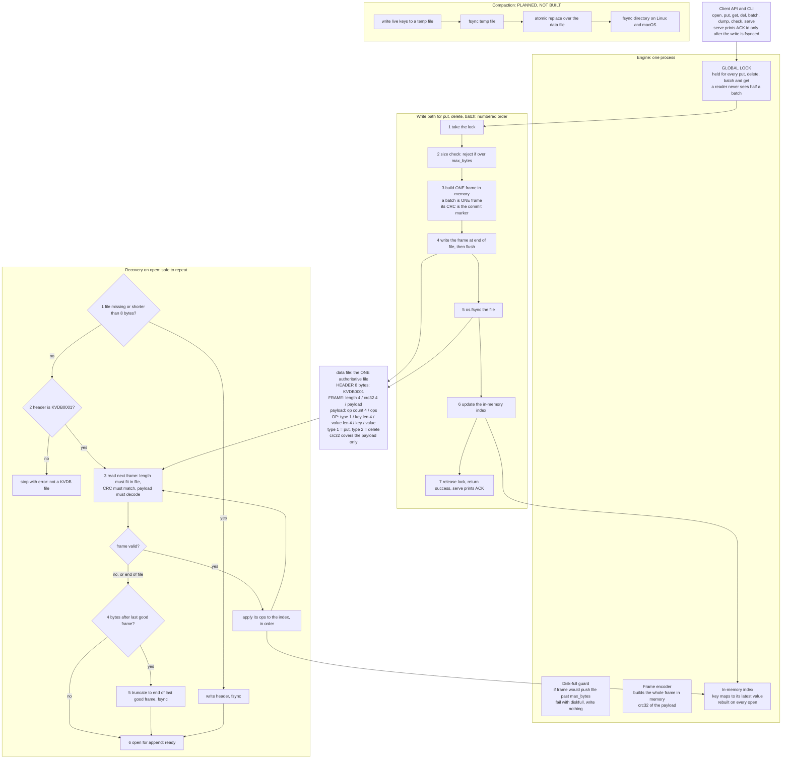

# ARCHITECTURE.md

KVDB: a single-file, crash-safe key-value store. Append-only log of CRC-protected frames, one in-memory index, one global lock. Written in Python (standard library only).

> **How to read this document honestly.** It describes the format and write/recovery steps in `README.md`. The "Where in code" column names the file and the step; replace each with the exact function name from `kvdb/kvdb.py`. The "Verified by" column says "Not verified yet" until you have run the named torture mode and can write the real seed. **Compaction is not built**, and the table says so instead of claiming a mechanism.

---

## Part 1: Architecture diagram

Source: `diagrams/architecture.mmd` (identical Mermaid text).



**Locks.** There is one lock: a process-wide mutex. `put`, `delete`, `batch` and `get` all take it. Writers are serialised, and a batch is applied to the index entirely inside one lock hold, so a reader sees the state before or after it. There is no lock file; the engine is single-process.

---

## On-disk format (full version in README.md)

All integers little-endian.

```
HEADER   8 bytes      "KVDB0001"
FRAME    repeated:    length u32 | crc32 u32 | payload (length bytes)
                      crc32 = CRC-32 of the payload only
PAYLOAD               op count u32 | op * count
OP                    type u8 (1 put, 2 delete) | key len u32 | value len u32 | key | value
```

Single put or delete = a frame with op count 1. A batch = one frame with op count 1 to 10,000.

**Why the CRC is the commit marker.** A batch is one frame with one CRC. There is no separate marker that could reach disk without its data, or the reverse. If the length fits and the CRC matches, every byte of every op is on disk; otherwise the whole frame is ignored.

**Frames that look valid but are not.** Eight zero bytes parse as length 0 and CRC 0, and the CRC-32 of an empty payload is 0. Recovery still rejects it because a payload under 4 bytes cannot hold an op count, so "the payload must decode" fails.

**Batch ordering (B5).** Ops are applied in listed order, later ops win. Recovery applies a frame's ops in the same order as the live path.

---

## Part 2: Scenario-to-mechanism proof table

"Write step n" = steps in the write-path box above. "Recovery step n" = the numbered recovery steps in README.md.

| Scenario | Disk state at the moment of the kill | Mechanism that handles it | Where in code | Verified by |
|---|---|---|---|---|
| **A1** kill before any bytes of a put reach the file | Before write step 4. The file ends at the last good frame. | Nothing to repair. No ACK was sent; the key is absent or keeps its previous value. | `kvdb.py`, write path, before step 4 | Default mode, seed 45637: 50/50 iterations passed (random kills) |
| **A2** torn write | After a partial write step 4. Fewer than `8 + length` bytes follow the last good frame, or the CRC does not match, or the payload does not decode. | Recovery step 3 stops at the first bad frame; recovery step 5 truncates to the end of the last good frame and fsyncs. Torn bytes are never applied or returned. | `kvdb.py`, recovery loop and truncate | Default mode, seed 45637: 50/50 iterations passed (random kills) |
| **A3** frame fully written, before fsync | Between write steps 4 and 5. A complete valid frame is in the OS cache; a process kill does not discard it. | Recovery sees a valid CRC and applies it. Either outcome is acceptable because no ACK was sent. | `kvdb.py`, write path, steps 4 to 5; recovery loop | Default mode, seed 45637: 50/50 iterations passed (random kills) |
| **A4** killed after fsync, before the caller hears success | Between write steps 5 and 7. Complete valid frame. | Recovery applies it. The key holds the new value even though the caller never got the ACK. | `kvdb.py`, write path step 5; recovery loop | Default mode, seed 45637: 50/50 iterations passed (random kills) |
| **A5** killed right after put returns | After write step 7. Complete valid frame, fsynced. | `serve` prints ACK only after the write returns, so every ACK implies the fsync is done. Recovery applies the frame. | `kvdb.py`, `serve` loop | Default mode, seed 45637: 50/50 iterations passed (random kills) |
| **A6** killed during a delete | No frame, a torn delete frame, or a complete delete frame (op type 2, value len 0). | No frame or torn frame (truncated): old value stays. Complete: key absent. A delete frame carries no value bytes, so it cannot create a corrupted value. | `kvdb.py`, delete path; recovery loop | Default mode, seed 45637: 50/50 iterations passed (random kills) |
| **A7** killed during a 1 MB put | A frame of about 1 MB plus overhead, partly written. | Same checks as A2: the length field points past the end of the file or the CRC fails, so recovery truncates the frame. | `kvdb.py`, write path; recovery loop | `--mode large-values`. Reported passing by the team. Mode and seed not recorded yet: [FILL IN] |
| **B1** killed after 3 of 10 batch ops written | One incomplete frame holding the batch. | A batch is one frame, so any missing byte fails the length or CRC check. It is truncated and none of the 10 ops is visible. | `kvdb.py`, batch path; recovery loop | Default mode, seed 45637: 50/50 iterations passed (random kills) |
| **B2** all 10 ops written, commit marker missing | There is no separate marker. The frame is either complete with a valid CRC, or incomplete. "Ops written, marker missing" is the same as B1. | Incomplete frame is truncated; nothing visible. | `kvdb.py`, recovery loop | Default mode, seed 45637: 50/50 iterations passed (random kills) |
| **B3** commit marker written, not fsynced | Between write steps 4 and 5. Complete batch frame in the OS cache. | Valid CRC, so all 10 ops are applied together. Never some. | `kvdb.py`, batch path; recovery loop | Default mode, seed 45637: 50/50 iterations passed (random kills) |
| **B4** killed after the batch returned | After write step 7. Complete batch frame, fsynced. | All 10 ops are applied at recovery. | `kvdb.py`, batch path; recovery loop | Default mode, seed 45637: 50/50 iterations passed (random kills) |
| **B5** put X and delete X in one batch | Same as B3/B4; ops are stored in the order given. | Ops are applied in listed order and later ops win, in the live path and in recovery. Rule stated in README.md. | `kvdb.py`, batch apply | Reported passing by the team. Test name and result not recorded yet: [FILL IN] |
| **B6** 10,000-op batch killed halfway | One partial frame. | Truncated by recovery step 5; nothing visible. Recovery time is the scan of the earlier frames (see F3). | `kvdb.py`, recovery loop | `--mode large-batches`. Reported passing by the team. Mode and seed not recorded yet: [FILL IN] |
| **C1** killed during open while replaying | Recovery has only read frames. If the file was shorter than the header, it may have written the header. | Replay does not modify the file, so running it again reaches the same state. | `kvdb.py`, recovery | Not verified yet. Target: `--mode recovery-crash` |
| **C2** killed while truncating a torn tail | Either the file is still long (truncate not applied) or already cut. | Truncation is to a fixed offset, so repeating it is harmless. The next open finds the same torn tail and cuts it again, or finds a clean file. | `kvdb.py`, recovery steps 5 | Not verified yet. Target: `--mode recovery-crash` |
| **C3** killed during compaction before the swap | Not applicable: compaction is not implemented, so there is no temp file or swap. | **No mechanism. Compaction is missing.** | none | Not implemented |
| **C4** killed during the rename or swap | Not applicable, same reason. | **No mechanism. Compaction is missing.** | none | Not implemented |
| **C5** killed after the swap, before temp cleanup | Not applicable, same reason. | **No mechanism. Compaction is missing.** | none | Not implemented |
| **C6** killed during close | Every acknowledged write was fsynced when it happened. | `close` adds nothing that has to be durable, so this is the same as a kill at any other time. (Confirm `close` writes nothing.) | `kvdb.py`, close | Not verified yet. Target: default mode |
| **D1** two writers, different keys | Frames of both writers are in the log in some serial order. | The global lock lets one operation at a time run write steps 1 to 7. Each ACKed frame was fsynced before its lock release. | `kvdb.py`, lock around write path | Default mode, seed 45637: 50/50 iterations passed (random kills), 2 concurrent writers |
| **D2** two writers, same key | Both frames are in the log, one after the other. | The lock gives a total order in the log. Recovery replays in log order, so the key holds the last complete frame's value. A value lives inside one CRC-protected frame, so two values never mix. | `kvdb.py`, lock; recovery loop | Default mode, seed 45637: 50/50 iterations passed (random kills), 2 concurrent writers (confirm the writers share keys) |
| **D3** one long batch, another writer doing single puts | The batch is one frame; single puts are separate frames before or after it. | The lock makes each operation atomic with respect to the others. A kill mid-batch leaves a torn frame (truncated). Single puts that were ACKed were fsynced earlier in the log. | `kvdb.py`, lock; batch path | `--mode large-batches`. Reported passing by the team. Mode and seed not recorded yet: [FILL IN] |
| **D4** reader during a batch (no crash) | Not a crash scenario. | `get` takes the same lock; the whole batch is applied to the index inside one lock hold. A reader sees before or after. | `kvdb.py`, get; batch path | Reported passing by the team. Test name and result not recorded yet: [FILL IN] |
| **E1** size cap reached during a single put | Nothing written for that put. | Write step 2: if the frame would exceed `--max-bytes`, the write fails with `ERR <id> diskfull`; file and index are unchanged, so reads still work. | `kvdb.py`, size check | Not verified yet. Target: `tests/test_cli.py` disk-full test |
| **E2** cap reached halfway through a batch | Nothing written for that batch. | The size check covers the whole batch frame before any byte is written. The batch is all written or fails with nothing written. | `kvdb.py`, size check; batch path | Not verified yet. Target: add a batch case to the disk-full test |
| **E3** cap reached, then killed | File ends at the last good frame; no partial frame exists because the check rejected the write first. | Normal recovery. All ACKed data intact. | `kvdb.py`, size check; recovery | Not verified yet. Target: disk-full torture mode (not written) |
| **E4** cap reached during compaction | Not applicable: no compaction. | **No mechanism. Compaction is missing.** | none | Not implemented |
| **E5** deletes free space, compaction runs, writes work again | Dead frames stay in the file; the file never shrinks. | **Not met.** Without compaction, deletes do not free space, so a database at its cap stays at its cap. | none | Not implemented |
| **F1** 500 random kills and restarts | Any of the states above. | Combination of everything above. | whole engine | Default mode, seed 45637: 50/50 iterations passed (random kills). The PDF asks for 500 iterations, so run `--iterations 500` and update this cell |
| **F2** kill, restart, kill during recovery, again | After the first kill, possibly a torn tail. After the second, truncation done or not. | Recovery only reads frames and truncates to a fixed offset, which is repeatable. | `kvdb.py`, recovery | Not verified yet. Target: `--mode recovery-crash` |
| **F3** 1,000,000 keys, killed, then open | A log of about 1M frames plus maybe a torn tail. | One sequential scan; no index file. **Whether this fits in 2 seconds in Python has not been measured.** | `kvdb.py`, recovery loop | **Not verified yet. Must be measured** |
| **F4** file truncated by 1 byte | The last frame is one byte short. | Its length does not fit, so recovery drops it and truncates. `open` succeeds and earlier frames are intact. | `kvdb.py`, recovery | Not verified yet. Target: `tests/test_cli.py::test_one_byte_chopped_off_the_end` |


### Test evidence recorded so far

| Run | Result |
|---|---|
| `torture_v2.py --mode default --seed 45637` | 50/50 iterations passed, 9,533 acknowledged operations, kills between 53 ms and 735 ms, including iterations where an in-flight operation was applied after the kill |

Random kills land at varying points in a write, so this run exercises the A, B and D scenarios statistically. It does not stop at one exact line. The large-value, large-batch and recovery-crash runs, the unit tests, and the 500-iteration run still need their mode, seed and result written down here.

**Still open:** C1, C2 (`--mode recovery-crash`), C3 to C5, E4, E5 (need compaction), E1 to E3 (disk-full runs), C6, F2, F3 (timing at 1,000,000 keys) and F4.

---

## Part 3: The three guarantees

**Durability.** A put, delete or batch is built as one frame in memory, written to the end of the file and flushed, and then `os.fsync` is called on the file. The lock is released, success is returned and `serve` prints `ACK <id>` only after that `fsync` returns. So every ACK implies the frame's bytes were already pushed to the disk before the ACK was printed. A kill after the ACK cannot remove them, and recovery re-reads them from the log. The `flush` moves Python's buffer to the OS and the `fsync` moves the OS's copy to disk; a process kill alone never discards bytes already given to the OS, while `fsync` also covers power loss.

**Atomicity.** A batch is a single frame whose CRC-32 covers all of its operations. Recovery applies a frame only if its length fits inside the file, its CRC matches and its payload decodes, and then it applies every operation of that frame in order. A frame cut off at any byte fails one of those checks and is removed by truncating the file to the end of the last good frame and calling `fsync`, so none of its operations reach the index. In a running process the batch is applied to the index while the global lock is held, and `get` needs the same lock, so a reader sees the state before the batch or after it.

**Recoverability.** `open` reads frames and changes only two things: it writes the 8-byte header if the file is shorter than that (which can only be a kill during first creation, before anything was acknowledged), and it truncates the file to the end of the last good frame. Both are repeatable. A kill at any instruction in recovery leaves a file that the next recovery handles the same way, so recovery can recover from a crashed recovery. A frame the engine never finished can only be the last one in the file, because writes are serialised by the lock and each earlier frame was fsynced before the next write began.

---

## Known gaps (copy into BREAKING.md section 3)

1. **No compaction.** The file only grows, so C3 to C5, E4 and E5 are unmet, and the PDF's file-shrink requirement fails (minus 5). This is the largest gap.
2. **Recovery time is linear in file size.** Not measured at 1,000,000 keys; Python may exceed 2 seconds. A checkpoint frame holding an index snapshot is the planned fix.
3. **Failed write in a live process.** If the OS fails a write halfway (a real disk error rather than the `--max-bytes` check), the file can end in a torn frame while the process keeps running. The next successful append would sit behind garbage and be unreachable at the next recovery. The engine should truncate back to the last good offset on any write error, or refuse further writes. Confirm what the code does.
4. **Header is not checksummed.** A header of 8 bytes is written in one call, so a torn header is shorter than 8 bytes and is rewritten. A damaged but full-length header is rejected as "not a KVDB file".
5. **CRC covers the payload, not the length.** A corrupted length field makes a frame look torn, so recovery discards it and everything after it. Bit rot is out of scope in the PDF, but this is what would happen.

## Planned compaction (not built)

Write live keys to a temp file, `fsync` it, `os.replace` it over the data file, then `fsync` the directory on Linux and macOS. On Windows the old file handle must be closed before the replace, and there is no directory fsync. Recovery gains one step: delete a leftover temp file. The rename is the commit point: before it the old file is authoritative, after it the new one is. Once built, this fills in C3 to C5, E4 and E5.